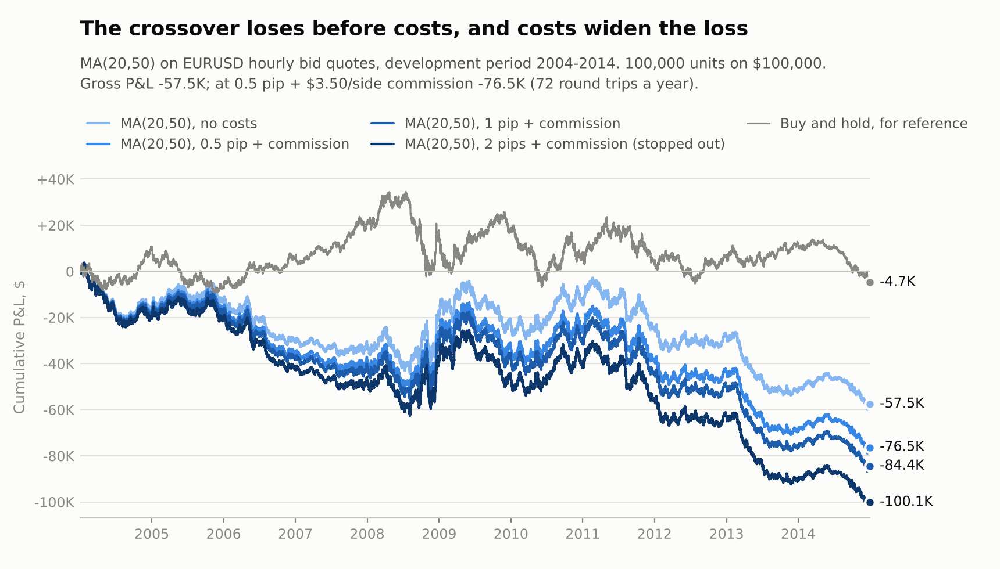
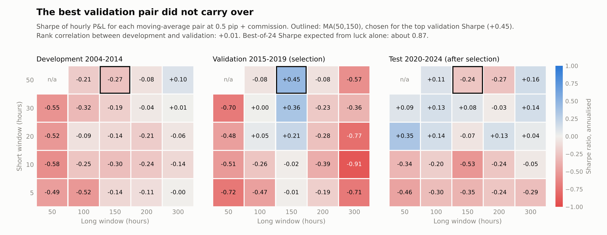
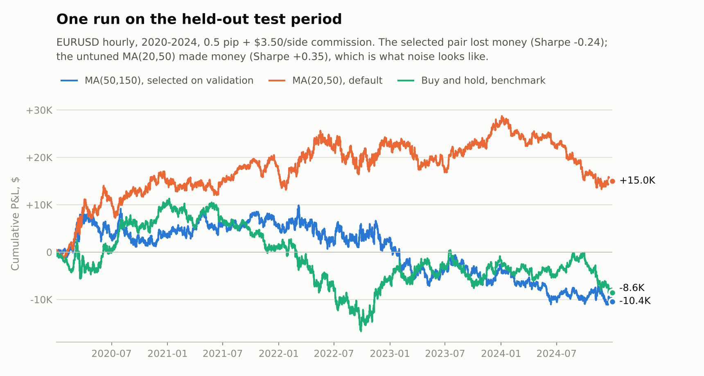

# C++ backtesting engine

An event-driven backtester for OHLC bar data, written in C++17 and built to produce numbers that can be trusted:
a strategy cannot see a bar before it closes, every trade pays explicit costs, and the results are checked
against hand calculations and against an independent Python implementation. It is used here to test
moving-average crossover strategies on 21 years of EURUSD (7.4 million one-minute bars).

**At a glance**

- **Correctness.** 46 GoogleTest cases, including a portfolio worked out by hand. A mutation check plants 24
  realistic bugs (look-ahead, wrong cost sign, missed fee, off-by-one warm-up...) and the tests catch all 24.
  On real data the engine agrees with an independent NumPy implementation on all 235,699 equity points and
  3,041 fills (largest difference: $0.0000000034). Clean under AddressSanitizer and UndefinedBehaviorSanitizer.
- **Speed.** Runs 21 years of EURUSD one-minute data (7.4M bars) in about 5 minutes. The CSV loader streams
  the file in 1 MiB chunks and parses with `std::from_chars`, so the whole file is never held in memory.
- **Finding.** The moving-average crossover showed no edge on EURUSD hourly bars. MA(20,50) lost $57.5K
  before costs over 2004-2014, and 0.5 pip plus commission added another $19.0K of losses. Parameter rankings
  did not persist between periods (rank correlation 0.01), and the pair chosen on the validation period lost
  money in the test period.

## Contents

[Design](#design) · [Verification](#verification) · [Experiments on EURUSD](#experiments-on-eurusd) ·
[Performance](#performance) · [Limitations](#limitations) · [Build and run](#build-and-run) · [Layout](#layout)

## Design

### The event loop

For every bar `t`, in order:

1. **Fill.** The target the strategy set after bar `t-1` closed is filled at bar `t`'s open, as a market order
   adjusted for spread and slippage, plus commission.
2. **Mark.** The position is valued at bar `t`'s close and an equity point is recorded.
3. **Decide.** The strategy is shown the bars that have closed (`0..t`) and returns its next target position.

A signal can therefore never trade at the price that produced it. This is enforced in the interface rather than
left to discipline: a strategy receives a `History` view whose size is `t + 1`, and indexing past it throws
(`StrategiesOnlySeeBarsThatHaveClosed` in the tests tries exactly that).

```cpp
class Strategy {
public:
    virtual double target_position(const History& closed_bars) = 0;  // units; the engine decides fills
    virtual void reset() {}
};
```

Strategies only state intent. They never touch cash or prices, so execution rules live in one place. That also
lets research code in another language use the engine: `bt_run --strategy file --targets FILE` replays a CSV
of `timestamp,target` rows written by, say, a Python model. Each row is matched to its bar by timestamp, bars
without a row are flat, the trade still happens at the next open with the usual costs, and a file whose
timestamps do not exist in the data is rejected rather than half-applied.

### Conventions

| Topic | Rule |
|---|---|
| Prices | `PriceBasis::Bid` for bid quotes such as HistData: buys pay the ask (bid + spread) plus slippage, sells receive the bid minus slippage. `PriceBasis::Mid` charges half the spread each way. |
| Commission | Per unit traded plus an optional fraction of notional. $3.50 per side per 100,000 units is `--commission-per-unit 0.000035`. |
| Accounting | Average cost. Adding keeps a weighted entry price, reducing realises P&L against it, a flip opens the remainder at the fill price. Invariant: equity = initial cash + realised + unrealised - fees. |
| Evaluation window | Equity is recorded for bars in `[start, end)`. Earlier bars are still shown to the strategy, so indicators warm up on history rather than inside the period being measured. Each window starts from fresh capital. |
| Stop-out | A fixed-size strategy can lose more than the account holds. When equity at a close falls to the stop-out level (default 0), the position is closed at the next open and trading stops, as a broker would. |
| Data | The loader never sorts, fills or drops rows. Missing columns, bad numbers or timestamps, non-positive prices, a high below the open/close/low, duplicates and out-of-order rows all stop the run with the file name and line number. |

### Metrics

All metrics come from the marked-to-market equity curve, never from a list of winning trades. The annualisation
factor is estimated from the data (observations per calendar year), so the same code works for minutes or hours,
and Sharpe ratios use a zero risk-free rate. Two views are reported:

- **Fixed capital.** Bar P&L in dollars scaled by the starting capital, without compounding. This suits
  strategies that trade a fixed number of units, and it stays defined after a ruinous loss. The experiments
  below quote this Sharpe ratio.
- **Compounding.** Bar returns `equity[t] / equity[t-1] - 1`, CAGR and drawdown from the running equity peak.
  Once equity reaches zero these are undefined, so a ruined account reports them as `null` instead of numbers.

That second rule came from the data. An early full-period run, before the stop-out existed, left equity below
zero for 21,434 hours, and the return-based metrics still reported a positive Sharpe ratio and a -114.6%
drawdown. The stop-out and the two metric views were added in response, with tests for both.

## Verification

**Unit tests** (`tests/`, 46 cases): timestamp parsing including leap years; every CSV rejection rule; cash,
position, average price and realised P&L through adds, partial closes, flips and shorts; the equity identity
over 2,000 random fills; both price bases; fills at the next open; no trade before the long window is full; the
warm-up window; the stop-out; monotone cost sensitivity; target files matched by timestamp; drawdown, CAGR,
Sharpe and exposure on paths small enough to check by hand.

The engine test `MatchesAHandCalculatedPortfolio` works through five bars with a 2-pip spread and commission:

| Bar | Open | Close | Target after close | Fill at this open | Equity at close |
|---|---:|---:|---:|---|---:|
| 0 | 1.1000 | 1.1010 | +1,000 | | 100,000.00 |
| 1 | 1.1010 | 1.1030 | +1,000 | buy 1,000 at 1.1011 | 100,001.89 |
| 2 | 1.1030 | 1.1020 | 0 | | 100,000.89 |
| 3 | 1.1020 | 1.1000 | -1,000 | sell 1,000 at 1.1019 | 100,000.78 |
| 4 | 1.1000 | 1.0980 | -1,000 | sell 1,000 at 1.0999 | 100,002.67 |

**Mutation check** (`tools/mutation_check.py`). Passing tests only mean something if they fail when the code is
wrong. The script copies the engine, plants one bug at a time and rebuilds: deciding and filling on the same
close, filling at the next close, trading the whole target instead of the change, sells skipping the spread,
fees never leaving cash, an unweighted average price, short P&L with the wrong sign, a warm-up one bar early or
late, a strategy allowed to read one bar ahead, duplicate timestamps accepted, a line split across read chunks,
the stop-out never firing or trading resuming after it, target files replayed by row instead of timestamp,
drawdown measured from the starting cash, 365-day years and more. **24 of 24 are caught.**

**Independent cross-check** (`python/reference_vectorised.py`, `python/tests/`). A second implementation shares no
code or algorithm with the engine: moving averages are summed window by window instead of with running sums,
and positions, fills, cash and equity are computed as whole NumPy arrays instead of in an event loop. The tests
run both on synthetic data, on the worked example above and on four real EURUSD configurations (one of them
stops out in 2017), and require every fill and equity point to match. The largest equity difference across
235,699 points was $3.4e-9. A third, plain-Python event loop (`python/reference_loop.py`) also agrees; it is the
baseline for the speed comparison.

**Sanitizers.** The test suite and a full 7.4-million-bar run are clean under `-fsanitize=address,undefined`.

## Experiments on EURUSD

**Data.** HistData EURUSD one-minute **bid** bars, 2004-01-01 19:00 to 2024-12-31 16:58, Eastern Standard Time
without daylight saving: 7,445,272 bars, resampled to 129,913 hourly bars (hours with no trades are dropped, not
filled). Every row passed the checks in `python/prepare_data.py`. The data is not redistributed here.

**Set-up.** 100,000 units per position (one standard lot) on $100,000, fresh capital at the start of each
period, stop-out at zero equity. Baseline costs: 0.5 pip on top of the bid quote plus $3.50 commission per side,
about 1.2 pips per round trip. Periods: development 2004-2014, validation 2015-2019, test 2020-2024. The test
period is only evaluated after the selection rule has picked its pair and written it to
`results/selection.json`, and nothing in the set-up was changed after the test results were seen.

### A. Costs (development period)

<picture>
  <source media="(prefers-color-scheme: dark)" srcset="results/figures/cost_sensitivity_dark.png">
  
</picture>

| Strategy | Costs | Net P&L | Return on capital a year | Sharpe | Worst drawdown on capital | Round trips a year | Costs paid |
|---|---|---:|---:|---:|---:|---:|---:|
| MA(20,50) | none | -$57.5K | -5.2% | -0.39 | -63.8% | 72 | $0 |
| MA(20,50) | 0.5 pip + commission | -$76.5K | -7.0% | -0.52 | -82.7% | 72 | $18,976 |
| MA(20,50) | 1 pip + commission | -$84.4K | -7.7% | -0.57 | -90.6% | 72 | $26,880 |
| MA(20,50) | 2 pips + commission | -$100.1K | -9.1% | -0.68 | -103.8% | 72 | $42,498 |
| MA(50,200) | none | -$7.6K | -0.7% | -0.05 | -36.2% | 18 | $0 |
| MA(50,200) | 0.5 pip + commission | -$12.4K | -1.1% | -0.08 | -38.1% | 18 | $4,864 |
| MA(50,200) | 2 pips + commission | -$18.5K | -1.7% | -0.13 | -42.6% | 18 | $10,938 |
| Buy and hold | 0.5 pip + commission | -$4.7K | -0.4% | -0.03 | -41.3% | 0 | $8.50 |

The fast crossover loses before any costs, and costs scale with how often it trades. It is always in the market,
so each signal flips the position with a 200,000-unit order: commission comes to about $1,000 a year, and each
0.5 pip of spread adds about $720 a year (with bid quotes the spread is paid on buys only). At 2 pips the
account was stopped out in December 2014.
For the runs that were not stopped out, gross P&L minus net P&L equals the costs paid to the cent, which is a
useful check that costs never change the trades themselves.

### B. Parameter search (development and validation)

<picture>
  <source media="(prefers-color-scheme: dark)" srcset="results/figures/parameter_grid_dark.png">
  
</picture>

24 pairs (short 5-50 hours, long 50-300 hours) at baseline costs. The rule, fixed in advance, was to take the
pair with the highest validation Sharpe: **MA(50,150)**, at +0.45. Three things suggest that number is mostly luck:

- Only 5 of 24 pairs had a positive validation Sharpe, and 2 of 24 in development.
- The ranking of pairs in development and validation was unrelated (Spearman rank correlation +0.01).
  MA(50,150) itself scored -0.27 in development.
- The best of 24 strategies with no edge at all would be expected to reach a Sharpe of about 0.87 over five
  years (an upper bound, since the 24 pairs are correlated). +0.45 is well inside that.

### C. Test period, after the choice was fixed

<picture>
  <source media="(prefers-color-scheme: dark)" srcset="results/figures/test_period_dark.png">
  
</picture>

| Strategy | Role | Net P&L | Return on capital a year | Sharpe | Worst drawdown on capital | Round trips a year |
|---|---|---:|---:|---:|---:|---:|
| MA(50,150) | selected on validation | -$10.4K | -2.1% | -0.24 | -21.0% | 24 |
| MA(20,50) | untuned default | +$15.0K | +3.0% | +0.35 | -15.5% | 66 |
| Buy and hold | benchmark | -$8.6K | -1.7% | -0.20 | -28.0% | 0 |

The selected pair lost money. The untuned MA(20,50), one of the worst pairs in development (Sharpe -0.52), had
the best test Sharpe of all 24. Running the whole grid on the test period afterwards (for diagnosis only, after
the choice was fixed) put MA(50,150) 15th of 24, with 10 of 24 pairs positive and a median Sharpe of -0.06. When
the best and worst parameters swap places from one period to the next, there is no reliable edge to trade.

## Performance

A full run over 21 years of EURUSD one-minute data (7.4M bars) takes about 5 minutes. The loader streams the
CSV in 1 MiB chunks and parses fields with `std::from_chars`, with no per-field allocations. The first version
read the whole file into memory; rewriting it this way removed that.

## Limitations

- **Bars, not ticks.** Orders fill at the next bar's open. There is no intrabar execution, order book, partial
  fill or latency, and only market orders.
- **One fixed spread for 21 years.** Retail EURUSD spreads were wider in 2004-2008 and widen around news and the
  daily rollover. With bid-only data the ask is approximated as bid plus that spread.
- **No financing.** Overnight swap is not charged or credited; for MA(50,150), which holds positions for days,
  this matters.
- **One instrument, fixed size.** No portfolio of instruments, no sizing from equity, no margin model beyond the
  stop-out, which is checked at closes, so a loss can overshoot it.
- **Statistics.** Sharpe ratios come from hourly P&L scaled by the square root of periods per year, with no
  adjustment for autocorrelation or weekend gaps. The luck yardstick assumes independent strategies.

## Build and run

Requirements: a C++17 compiler, CMake 3.16+, and Python 3.10+ for the data preparation, cross-checks and
experiments. Developed and tested with GCC 13 on Linux; the code uses only standard C++17, so recent Clang and
MSVC should build it too. GoogleTest is downloaded at configure time (`-DBT_BUILD_TESTS=OFF` skips it).

```bash
cmake -S . -B build -DCMAKE_BUILD_TYPE=Release
cmake --build build --config Release
build/bt_tests                               # 46 tests (or: ctest --test-dir build -C Release)
```

CLion and Visual Studio open the folder directly as a CMake project. Build the Release configuration before
running the Python scripts; they look for the executables in `build/`, `build/Release/` and CLion's
`cmake-build-release/`, or in the folder named by the `BT_BUILD_DIR` environment variable.

Prepare the data from HistData one-minute files (or a pandas pickle of them), then run everything:

```bash
python -m pip install -r python/requirements.txt
python python/prepare_data.py --histdata path/to/folder/with/DAT_ASCII_EURUSD_M1_files
#   or: python python/prepare_data.py --pickle path/to/HD_EURUSD_1min_2004-2024.pkl
python -m pytest python/tests                # cross-checks against the engine (13 tests)
python python/run_experiments.py             # experiments A-D -> results/experiments.json
python python/make_figures.py                # results/figures/*.png
python tools/mutation_check.py               # plants 24 bugs, expects every one to be caught
```

One backtest from the command line (prints metrics as JSON; `--out` also writes equity, fills and metrics):

```bash
build/bt_run --data data/eurusd_1h.csv --strategy ma --short 20 --long 50 --units 100000 \
  --basis bid --spread 0.00005 --commission-per-unit 0.000035 \
  --start 2015-01-01 --end 2020-01-01 --out results/run
build/bt_run --data data/eurusd_1h.csv --strategy file --targets my_model_targets.csv --basis bid --spread 0.00005
build/bt_bench --data data/eurusd_1m.csv --repeat 5
```

On Windows the executables end in `.exe`, and Visual Studio puts them in `build\Release\`.

## Layout

```
include/bt/        public headers: types, csv, costs, portfolio, strategy (History view), engine, metrics, report
src/               engine, portfolio and costs, strategies, metrics, CSV loader, report writers
apps/bt_run.cpp    command-line backtest
benchmarks/        bt_bench: load time and best/median loop time
tests/             GoogleTest suite
python/            data preparation, NumPy and plain-Python references, cross-check tests, experiments, figures
tools/             mutation check
examples/          small synthetic data sets used by the tests
results/           experiments.json, selection.json, figures
```
